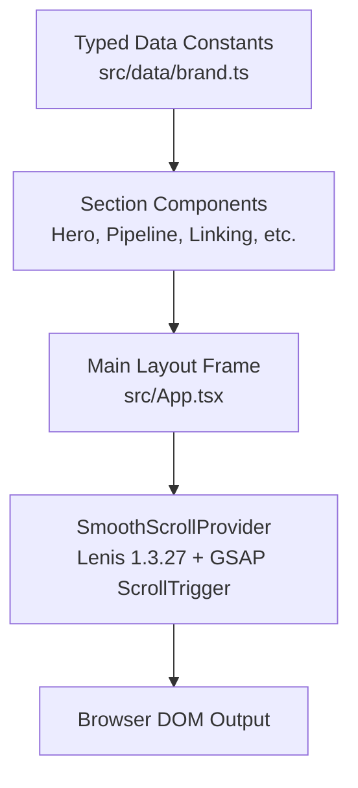

<!-- Centered Organization & Project Logos -->
<div align="center">
  <div style="display: flex; align-items: center; justify-content: center; gap: 24px;">
    
    
  </div>

  # Gitcord Landing Page

  A calm, documentation-style landing page for [Gitcord](https://github.com/AOSSIE-Org/Gitcord-GithubDiscordBot) (Discord-GitHub Automation Engine by AOSSIE).

  [](LICENSE)
  [](https://react.dev/)
  [](https://www.typescriptlang.org/)
  [](https://tailwindcss.com/)
  [](https://gsap.com/)
  [](https://lenis.darkroom.engineering/)

</div>

---

## Overview

This repository contains the marketing and documentation landing page for **Gitcord**, an open-source, local-first automation engine developed by **AOSSIE**.

### Who This Site Is For
- **Contributors:** Step-by-step guidance on linking GitHub accounts (`/link`, `/verify-link`), checking profile status, and tracking PR health without leaving Discord.
- **Mentors & Maintainers:** Information on dry-run safety, deterministic planning, `/pr-channel` routing, scheduled sync via Docker, and permission boundaries.

---

## Section Status (MVP & Future Additions)

| Section | Target Anchor | Description | Status |
| :--- | :--- | :--- | :--- |
| **01 Navbar** | Top | Sticky 56px solid header, logo, anchor navigation, GitHub link, mobile drawer | **Completed (MVP)** |
| **02 Hero** | `#hero` | Asymmetrical 7:5 split: headline, facts, action buttons, flat architecture mockup | **Completed (MVP)** |
| **03 How Gitcord Works** | `#how-it-works` | 4-step pipeline block (Read ➔ Plan ➔ Report ➔ Apply) and boundary callout | **Completed (MVP)** |
| **04 Link Your Account** | `#linking` | 4-step identity verification walkthrough with sticky Discord chat mockup | **Completed (MVP)** |
| **05 Features Reference** | `#features` | Clean two-column reference table of verified engine capabilities | **Completed (MVP)** |
| **06 Quick Start** | `#quickstart` | Tabbed code blocks for Docker Compose and local Python 3.11+ setup | **Completed (MVP)** |
| **07 Footer** | Bottom | 4-column documentation footer, Contributing link, GPL-3.0 license note | **Completed (MVP)** |

*More sections planned for post-MVP review: PR lifecycle event timeline (`#pr-flow`), full searchable slash command reference table (`#commands`), and safety & permission comparison (`#safety`).*

---

## Tech Stack (Exact Pinned Versions)

All dependencies in [`package.json`](package.json) are pinned without `^` or `~`:

| Package | Version | Purpose |
| :--- | :--- | :--- |
| `react` / `react-dom` | `19.3.1` | Core UI library |
| `typescript` | `6.0.3` | Strict type checking with zero `any` |
| `vite` | `8.3.4` | Build tool and local development server |
| `tailwindcss` | `3.4.19` | Utility styling with custom `Brand.md` color tokens |
| `postcss` | `8.5.31` | CSS transformation pipeline |
| `autoprefixer` | `10.6.1` | Cross-browser CSS prefixing |
| `gsap` | `3.15.0` | Controlled animations (ScrollTrigger) |
| `@gsap/react` | `2.1.2` | React lifecycle hooks for GSAP context |
| `lenis` | `1.3.27` | Smooth scrolling engine connected to GSAP ticker |
| `lucide-react` | `1.61.0` | Accessible functional icons |
| `eslint` | `10.13.0` | Linting and code quality |
| `prettier` | `3.9.10` | Consistent formatting |

---

## Architecture



### Directory Structure

```text
gitcord-landing/
├── docs/                 # In-depth architectural references (GITCORD_OVERVIEW.md)
├── public/               # Static assets, Open Graph card, and brand catalog
│   ├── brand/            # Official AOSSIE and Gitcord logos and ASSETS.md
│   │   ├── aossie/       # Official AOSSIE emblems (SVG, PNG)
│   │   ├── gitcord/      # Official Gitcord icons and logomarks (SVG, PNG)
│   │   └── optimized/    # Pure-vector SVGs optimized for fast rendering
│   └── og-template.html  # 1200x630 Open Graph card template
├── src/                  # Application source code
│   ├── components/       # Reusable UI components
│   │   ├── common/       # Accessible skip-link and SVG icons
│   │   ├── layout/       # Sticky Navbar and 4-column Footer
│   │   └── sections/     # Individual landing page sections (Hero, Pipeline, Linking)
│   ├── context/          # Lenis + GSAP ScrollTrigger context and useSmoothScroll hook
│   ├── data/             # Strictly fact-checked navigation and command data
│   ├── App.tsx           # Layout assembly
│   ├── index.css         # Tailwind directives and Brand.md root CSS variables
│   └── main.tsx          # React application root
├── package.json          # Pinned dependency manifests and minimum engine requirements
├── tailwind.config.ts    # Custom design tokens, typography, and contrast rules
└── tsconfig.json         # Strict TypeScript compiler options
```

---

## Design Principles

1. **Calm, Flat Documentation Style:**
   - Inspired by GitHub Docs, Stripe Docs, and Linear Docs.
   - Solid brand colors (`#0D1117` dark background, `#161B22` surface, 1px `#30363D` borders, 4–8px radius).
   - Zero glassmorphism, no neon gradients, no glow effects, and no generic card grids with large icon boxes.
2. **Typography & Line Length:**
   - Left-aligned text in `Inter` with a comfortable reading length (~65 characters). Monospace for commands and file paths.
3. **Restrained Animation Budget:**
   - Smooth scrolling via Lenis.
   - Purposeful animations strictly in two sections: (1) Account Linking step-through, and (2) PR flow highlight.
   - Everything else is static with standard 150ms hover/focus color changes.
4. **Accessibility (WCAG AA):**
   - Canonical muted text `#8B949E` verified at **6.13:1** contrast on `#0D1117` and **5.56:1** on `#161B22`.
   - `prefers-reduced-motion` fully respected (destroys Lenis, skips GSAP animations).
   - "Skip to main content" link for keyboard navigation.

---

## Content Rules

- **Zero Fabricated Claims:** All feature statements, command descriptions, and configuration options are derived verbatim or near-verbatim from the upstream repository docs (`README.md`, `INSTALLATION.md`, `QUICK_START_GUIDE.txt`, `TECHNICAL_DOCUMENTATION.md`).
- **Illustrative Labels:** Every visual mockup (terminal sessions, Discord chat cards, GitHub PR previews) is explicitly tagged with **`Illustrative example`**.
- **No Invented Numbers:** The site contains no fabricated active user counts, server statistics, or star counters.

---

## Getting Started

### Prerequisites

Minimum engine versions specified in `package.json`:
- **Node.js:** `>=20.0.0`
- **pnpm:** `>=9.0.0`

### Installation & Execution (PowerShell-Safe)

Run each command on its own line:

```powershell
# 1. Install pinned dependencies
pnpm install

# 2. Start local development server
pnpm run dev

# 3. Check code formatting and rules
pnpm run lint

# 4. Compile and verify production build
pnpm run build

# 5. Preview production build locally
pnpm run preview
```

---

## How to Edit Content

To keep copy easily maintainable and fact-checked, content is decoupled into typed data files:
- **Navigation & Links:** [`src/data/brand.ts`](src/data/brand.ts)
- **Pipeline Stages:** [`src/components/sections/PipelineSection.tsx`](src/components/sections/PipelineSection.tsx)
- **Linking Steps & Mockups:** [`src/components/sections/LinkingSection.tsx`](src/components/sections/LinkingSection.tsx)

---

## Brand Assets & Licensing

- **Brand Assets Notice:** The official logos and marks in `public/brand/` belong to **AOSSIE** and the **Gitcord project**. They are not licensed under this repository's software license. For full asset details, see [`public/brand/ASSETS.md`](public/brand/ASSETS.md).
- **Code License:** This landing page project is licensed under the **GNU General Public License v3.0 (GPL-3.0)** to match the upstream Gitcord automation engine. See [`LICENSE`](LICENSE) for details.

---

## Reference Links

| Resource | Link |
| :--- | :--- |
| **Upstream Gitcord Repository** | [github.com/AOSSIE-Org/Gitcord-GithubDiscordBot](https://github.com/AOSSIE-Org/Gitcord-GithubDiscordBot) |
| **Gitcord Installation Guide** | [`INSTALLATION.md`](https://github.com/AOSSIE-Org/Gitcord-GithubDiscordBot/blob/main/INSTALLATION.md) |
| **Gitcord Technical Documentation** | [`TECHNICAL_DOCUMENTATION.md`](https://github.com/AOSSIE-Org/Gitcord-GithubDiscordBot/blob/main/TECHNICAL_DOCUMENTATION.md) |
| **Docker Deployment Guide** | [`docs/DOCKER.md`](https://github.com/AOSSIE-Org/Gitcord-GithubDiscordBot/blob/main/docs/DOCKER.md) |
| **Brand Specifications** | [`brand/Brand.md`](https://github.com/AOSSIE-Org/Gitcord-GithubDiscordBot/blob/main/brand/Brand.md) |
| **AOSSIE Discord (#gitcord thread)** | [AOSSIE Discord Community](https://discord.com/channels/1022871757289422898/1465995983791063140) |
| **Contributing Guidelines** | [`CONTRIBUTING.md`](https://github.com/AOSSIE-Org/Gitcord-GithubDiscordBot/blob/main/CONTRIBUTING.md) |

---

## Acknowledgements

- **AOSSIE (Australian Open Source Software Innovation and Education):** For open-source mentorship and sponsorship under Google Summer of Code (GSoC).
- **Gitcord Project Maintainers:** For building and documenting the offline-first deterministic Discord-GitHub automation engine.
